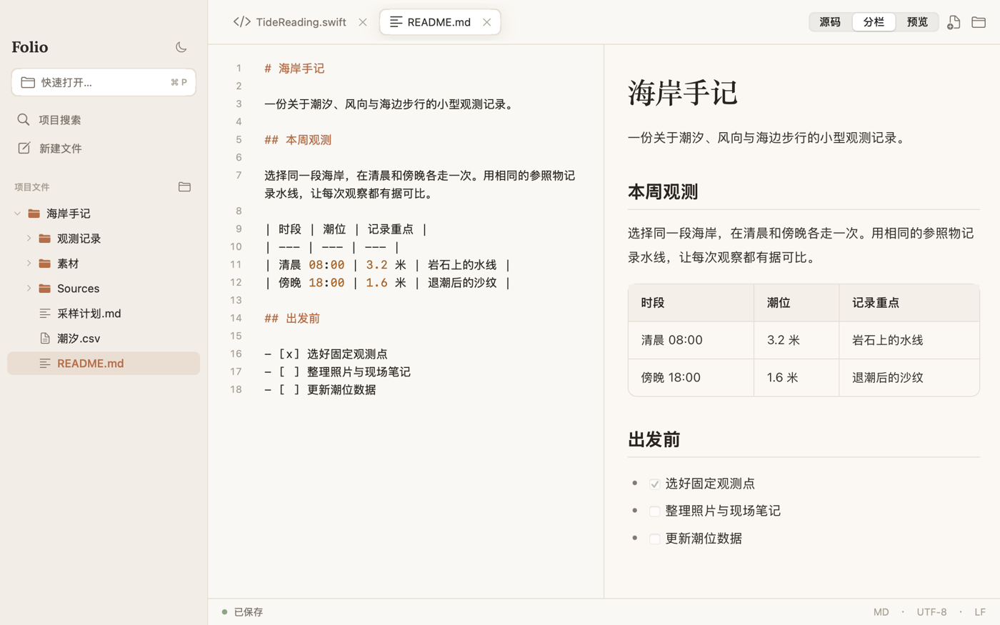
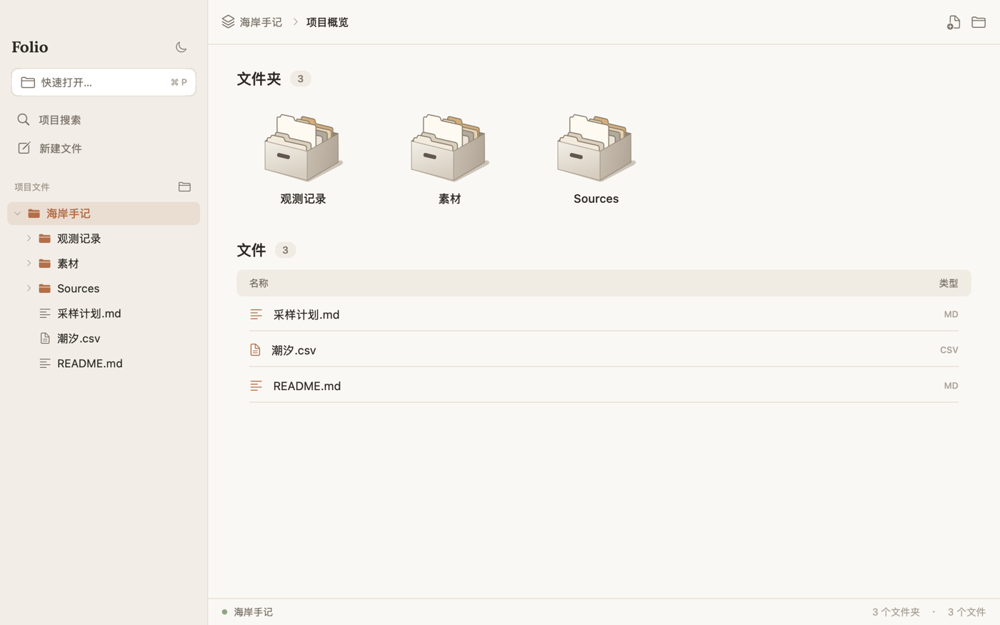
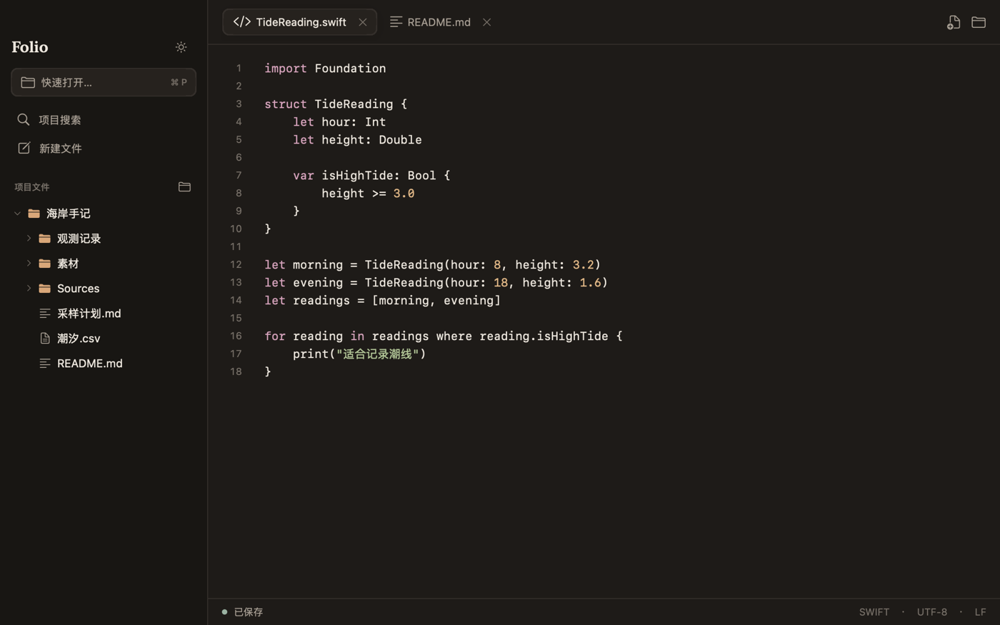

# Folio

Folio 是一个使用 Swift 和 AppKit 编写的 macOS 本地编辑器。可以把代码仓库、笔记目录和素材文件夹一起拖进窗口，跨项目搜索文件，也可以一边写 Markdown，一边看排版结果。



## 安装与更新

从 [GitHub Releases](https://github.com/moosl/Folio/releases/latest) 下载正式 ZIP，解压后将 Folio.app 拖到「应用程序」。当前发布包适用于 **Apple Silicon、macOS 13 或更高版本**。同一个包适配经典和新版 macOS 图标。

从 **0.2.0** 起，可以在 **Folio → 检查更新…** 中检查、下载并安装新版。更新由 Sparkle 验签，正式应用使用 Apple Developer ID 签名，并经过公证。更早的版本需要手动安装一次 0.2.0 或更高版本。

## 使用

- **浏览项目** — 单击文件进入临时预览，双击或开始编辑会固定标签。右键文件夹可以新建文件、创建子文件夹或复制路径。重新启动后会恢复项目、标签顺序和当前文件。
- **查找与编辑** — 快速打开支持模糊匹配。项目全文搜索遵守忽略规则，也会搜索已打开文件中的未保存修改。打开匹配项会跳到对应行。
- **写 Markdown** — 在源码、分栏和预览之间切换。支持 YAML 元数据、表格、任务列表、代码块和本地图片。
- **跟随磁盘变化** — 外部程序修改文件后，干净的标签会自动刷新。有未保存编辑时保留草稿，可以比较两个版本再决定如何处理。
- **查看素材** — 在标签页中查看图片、播放 MP3，或把 HTML 交给默认浏览器。

| 项目概览 | 深色代码编辑器 |
| --- | --- |
|  |  |

### 常用快捷键

| 快捷键 | 操作 |
| --- | --- |
| ⌘N | 新建文件 |
| ⌘O / ⇧⌘O | 打开文件 / 添加项目文件夹 |
| ⌘P / ⇧⌘F | 快速打开 / 跨项目全文搜索 |
| ⌘F / ⌥⌘H | 当前文件查找 / 替换 |
| ⌘S / ⇧⌘S | 保存 / 另存为 |
| ⌘E | 切换 Markdown 源码与预览 |
| ⌘+ / ⌘− | 调整当前标签字号 |
| ⌘1 / ⌘W | 返回项目概览 / 关闭标签 |

## 从源码构建

需要 macOS 和 Xcode Command Line Tools。首次构建会下载并校验固定版本的 cmark-gfm、libyaml、ripgrep 和 Sparkle。脚本为当前 Mac 架构生成应用。

```sh
git clone https://github.com/moosl/Folio.git
cd Folio
bash scripts/build.sh
open dist/Folio.app
```

在已登录的 macOS 图形会话中运行 `bash scripts/test.sh`。测试会在临时目录打开真实窗口，覆盖编辑、预览、搜索、文件监听、会话恢复和源码文件显示。性能数据和复现命令见 [性能报告](PERFORMANCE.md)。

## 发布新版本

1. 递增 `app/Info.plist` 中的 `CFBundleVersion`，并设置新的 `CFBundleShortVersionString`（如 `0.2.1`）。提交代码并推送对应的 Git 标签（如 `v0.2.1`）。
2. 在发布 Mac 上配置 Developer ID Application 签名身份、已认证的 `asc` 和钥匙串里的 Sparkle 更新签名密钥。运行 `bash scripts/release.sh`，生成公证 ZIP 和签名的 `dist/appcast.xml`。
3. 在同一 GitHub Release 草稿上传这两个文件，确认 ZIP 文件名与清单一致，再作为 **Latest** 发布。已安装的客户端会从固定入口取得最新清单。

本项目的 Sparkle 公钥和更新地址在 `app/Info.plist`。分发自己的 fork 时，请换用自己的更新地址、公钥、签名密钥账户及发布仓库。私钥保存在发布者的钥匙串中。

## 许可证

Folio 使用 [MIT License](LICENSE)。cmark-gfm、libyaml、ripgrep 和 Sparkle 各自的许可声明随构建产物附带。
