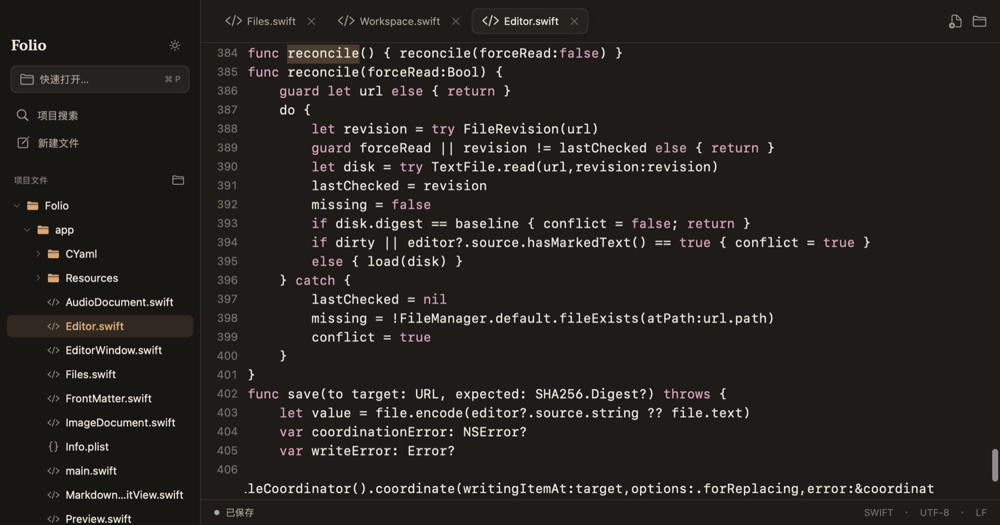
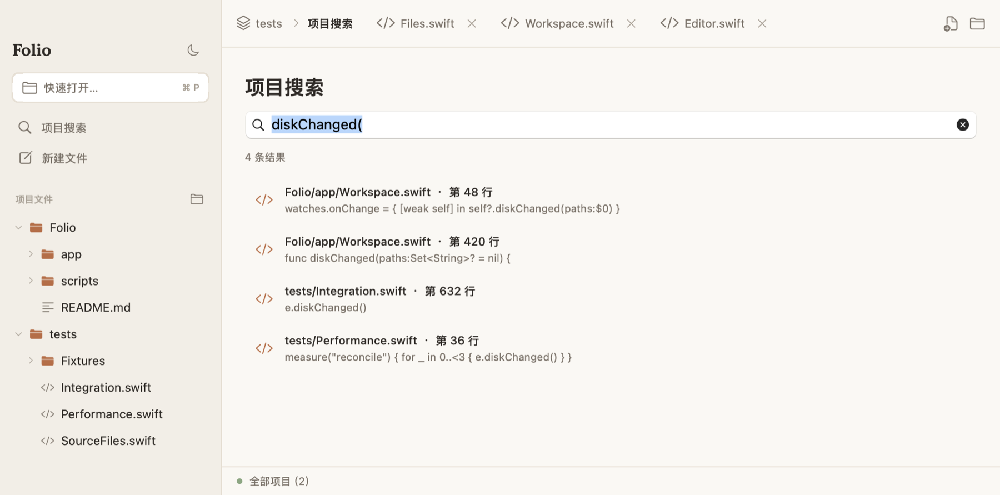

# Folio

**Folio 是一款启动快、内存占用小的原生 macOS 代码编辑器，适合主要用 Codex、Claude Code 等 AI agent 开发的人。**

agent 说「改好了」，你想看一眼它改的函数，搜搜哪里还在调用它；有时只是想读完一份 Markdown 实现计划。如果专门为这些事打开 VS Code 觉得太重，把项目文件夹拖进 Folio 就行。

在 Apple M3（macOS 15.7.3）上，Folio 从启动到空窗口出现约 **0.23 秒**，此时主进程占用约 **20 MiB**（预热后独立启动 5 次的中位数）。在多标签测试中，同时打开 20 份共 77 MiB 的代码文件后，主进程占用约 **72 MiB**。[查看性能实测](PERFORMANCE.md)

[下载 macOS 版 · Apple Silicon](https://github.com/moosl/Folio/releases/latest)



## 在 agent 工作时看代码

1. **打开它提到的文件。** 比如 Codex 说修改了 `Editor.swift`，按 ⌘P 输入文件名就能打开。想顺着目录多看几份文件，可以在左侧单击逐个预览，双击留下要反复对照的标签。
2. **找到改动影响的地方。** 按 ⇧⌘F 搜索函数名或一段代码，点结果直接跳到对应行。同时打开多个项目时，一次搜索就能覆盖它们；搜索遵守项目的忽略规则，也包含你的未保存修改。
3. **边看边等下一次改动。** agent 写回磁盘后，干净的标签会自动刷新。若你也在改同一文件，Folio 会保留草稿，并提供与磁盘版本比较的入口。下次启动时，之前的项目和文件标签会恢复。

下图在 Folio 的源码和测试目录中搜索 `diskChanged(`，可以同时看到文件监听的入口和测试里的调用。



## 读计划和项目文档

在同一个窗口打开 README、设计说明或 agent 写的 Markdown 计划。按 ⌘E 切换源码与预览，也可以分栏核对表格、任务列表和本地图片。PDF 可以直接在标签页中连续翻页、选择文字，无需切换应用。图片和 MP3 也可以直接预览，HTML 可以交给默认浏览器打开。

## 安装与更新

从 GitHub Releases 下载 ZIP，解压后把 `Folio.app` 拖入「应用程序」。正式包适用于 **Apple Silicon、macOS 13 或更高版本**。[下载最新版本](https://github.com/moosl/Folio/releases/latest)

从 0.2.0 起，在 **Folio → 检查更新…** 中即可安装新版。正式应用使用 Apple Developer ID 签名并经过公证，Sparkle 会验证更新签名。更早的版本需要先手动安装一次。

<details>
<summary>安装 0.2.0 时遇到「Apple 无法验证 Folio」</summary>

部分解压工具会在 0.2.0 的 Sparkle.framework 中留下额外的 `._*` 文件。请下载 0.2.1 或更高版本，在访达中替换「应用程序」里的旧副本。

</details>

## 常用操作

| 快捷键 | 操作 |
| --- | --- |
| ⌘P / ⇧⌘F | 按文件名打开 / 跨项目搜索正文 |
| ⌘O / ⇧⌘O | 打开文件 / 添加项目文件夹 |
| ⌘F / ⌥⌘H | 当前文件查找 / 替换 |
| ⌘D | 选中光标处的词；继续按，依次追加下一个匹配项，可同时编辑；Esc 退出多选 |
| ⇧⌘L / ⌘L | 选中所有匹配项 / 选中当前行 |
| ⌘E | 切换 Markdown 源码与预览 |
| ⌘N / ⌘S / ⇧⌘S | 新建文件 / 保存 / 另存为 |
| ⌘+ / ⌘− | 调整当前标签字号 |
| ⌘1 / ⌘W | 返回项目概览 / 关闭标签 |

右键文件夹可以新建文件或子文件夹；右键文件或目录可以复制路径，方便贴回与 agent 的对话。

## 从源码构建

需要 macOS 和 Xcode Command Line Tools。首次构建会下载并校验固定版本的 cmark-gfm、libyaml、ripgrep 和 Sparkle。脚本为当前 Mac 架构生成应用。

```sh
git clone https://github.com/moosl/Folio.git
cd Folio
bash scripts/build.sh
open dist/Folio.app
```

在已登录的 macOS 图形会话中运行 `bash scripts/test.sh`。测试会在临时目录打开真实窗口，覆盖编辑、预览、搜索、文件监听、会话恢复和源码文件显示。性能数据和复现命令见 [性能报告](PERFORMANCE.md)。

## 维护与发布

本项目通过稳定版本 tag 触发发布，由本机 LaunchAgent 完成签名、公证和 Sparkle 更新清单同步。发布机配置、tag 命令、验证步骤和故障排查见[维护指南](AGENTS.md)。

## 许可证

Folio 使用 [MIT License](LICENSE)。cmark-gfm、libyaml、ripgrep 和 Sparkle 各自的许可声明随构建产物附带。
